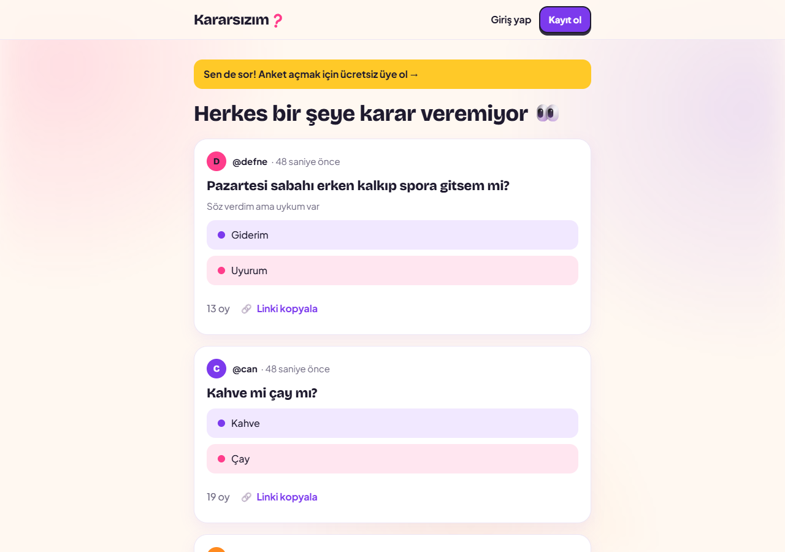
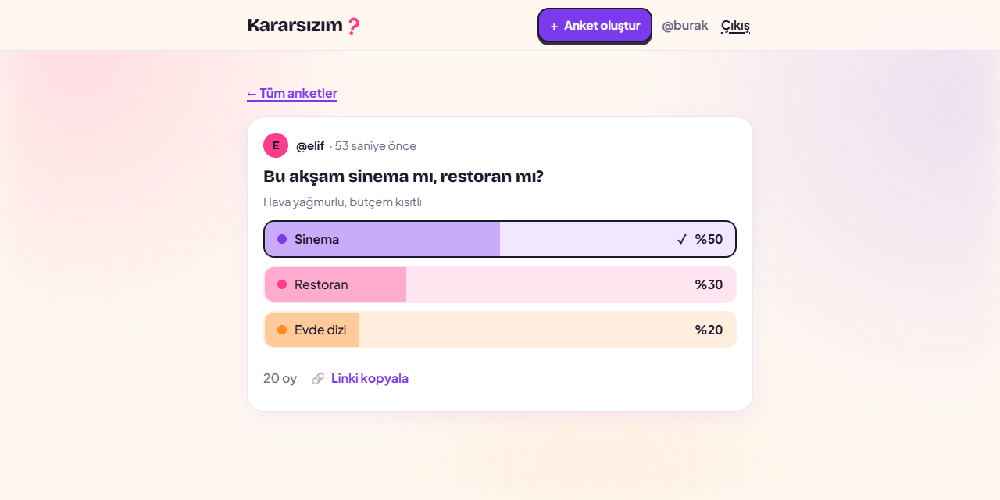
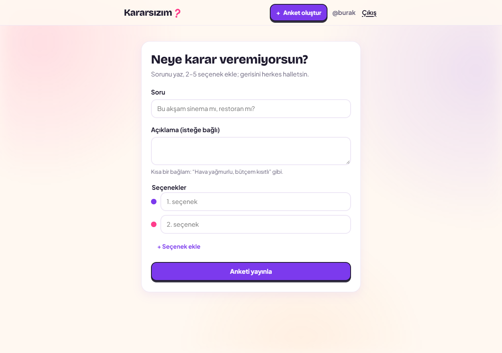
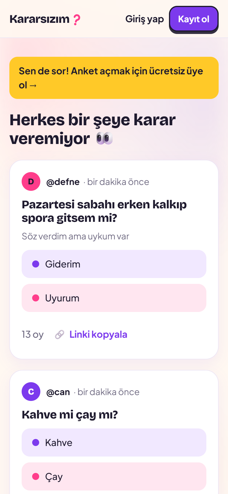
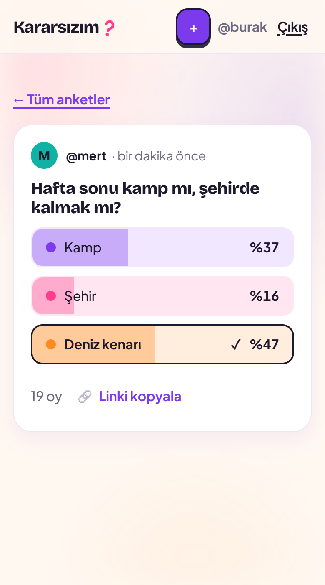

# Kararsızım ❓

Kararsız kaldığın bir konuda saniyeler içinde anket aç, herkes oy versin, sonucu yüzdelerle gör.

> *"Bu akşam sinema mı, restoran mı?"* → 2–5 seçenek → oylar → yüzdeler

Django 5.2 ve saf HTML/CSS/JS ile yazılmış bir prototip. Framework yok, build adımı yok, npm yok.

| Akış | Oy sonrası sonuçlar |
|---|---|
|  |  |

## Nasıl çalışır?

- **Herkes görür, herkes oy verir.** Anketleri görmek ve oy vermek için üyelik gerekmez.
- **Anket açmak için üyelik gerekir.** Üye olmayan "Anket oluştur"a tıklarsa girişe yönlenir, giriş sonrası forma geri döner.
- **2–5 seçenek.** Her seçenek kendi rengini alır.
- **Sonuçlar oydan sonra açılır.** Oy vermeden yüzdeler gizlidir, böylece sonuç seni etkilemez. Anket sahibi sonuçları her zaman görür.
- **Oy kesindir.** Değiştirilemez, geri alınamaz. Anket sahibi anketini silebilir.
- **Takip sistemi yok.** Platformdaki tüm anketler tek akışta.
- **Gizlilik.** Anketlerde yalnızca `@kullaniciadi` görünür. E-posta hiçbir yerde (sayfa, JSON, profil) gösterilmez.
- **JavaScript kapalıyken de çalışır.** Oy verme düz bir form gönderimidir; JS açıkken sayfa yenilenmeden sonuçlar çubuklarla dolar.

<table>
<tr>
<td width="50%"></td>
<td width="25%"></td>
<td width="25%"></td>
</tr>
<tr>
<td align="center">Anket oluşturma</td>
<td align="center" colspan="2">Mobil öncelikli arayüz</td>
</tr>
</table>

## Özellikler

- E-posta + parola + kullanıcı adı ile kayıt; giriş e-posta ile
- Üyeler ve anonim ziyaretçiler için oy verme (anonimler imzalı çerezle takip edilir, tekrar oy verilemez)
- Animasyonlu sonuç çubukları; yüzdelerin toplamı her zaman tam 100
- Kullanıcı profili (`/u/<kullanıcı-adı>/`), "Linki kopyala" ile paylaşım
- Her ankette paylaşım önizlemesi için `og:` meta etiketleri
- Erişilebilirlik: klavye ile gezinme, görünür odak stili, `prefers-reduced-motion` desteği

## Teknoloji

| | |
|---|---|
| Dil / framework | Python 3.14, Django 5.2 (LTS) |
| Veritabanı | Supabase PostgreSQL (yerelde SQLite). Supabase yalnızca Postgres olarak kullanılır; kimlik doğrulama Django'nun kendi sistemidir |
| Statik dosyalar | WhiteNoise |
| Deploy | Vercel |
| Frontend | Django şablonları, tek CSS dosyası, iki küçük JS dosyası |

Ayrıntılı ürün kararları, veri modeli ve faz planı: [docs/PROJECT.md](docs/PROJECT.md).

## Yerel kurulum

Gereken: Python 3.14.

```bash
python -m venv .venv
.venv\Scripts\activate          # macOS/Linux: source .venv/bin/activate
pip install -r requirements.txt
copy .env.example .env          # macOS/Linux: cp .env.example .env
python manage.py migrate
python manage.py createsuperuser
python manage.py runserver
```

Uygulama http://localhost:8000 adresinde açılır. `DATABASE_URL` tanımlı değilse yerel SQLite (`db.sqlite3`) kullanılır.

## Testler

```bash
python manage.py check
python manage.py test
```

Testler her zaman yerel SQLite üzerinde çalışır.

## Proje yapısı

```
config/      Django ayarları (ortam değişkenleriyle yönetilir)
accounts/    Kullanıcı modeli, kayıt / giriş / çıkış
polls/       Anket, seçenek, oy; oylama mantığı (services.py), anonim ziyaretçi çerezi (voter.py)
templates/   Sayfa şablonları ve ortak parçalar (partials/)
static/      main.css, main.js, poll-form.js, logo ve favicon
docs/        Proje planı (PROJECT.md) ve ekran görüntüleri
```

## Ortam değişkenleri

| Değişken | Varsayılan | Açıklama |
|---|---|---|
| `DJANGO_SECRET_KEY` | geliştirme anahtarı | `DJANGO_DEBUG=False` iken zorunlu |
| `DJANGO_DEBUG` | `True` | Canlıda `False` |
| `DJANGO_ALLOWED_HOSTS` | `localhost,127.0.0.1,.vercel.app` | Virgülle ayrılmış |
| `DJANGO_CSRF_TRUSTED_ORIGINS` | boş | Örn. `https://kararsizim.vercel.app` |
| `DATABASE_URL` | yok → SQLite | Supabase bağlantı dizesi |

Gerçek değerleri (secret key, veritabanı parolası) asla repoya yazma; `.env` dosyası git'e girmez.

## Yayına alma (Supabase + Vercel)

1. **Supabase:** Yeni proje aç. "Connect" menüsünden iki bağlantı dizesi al: *transaction pooler* (port 6543, uygulama için) ve *session pooler* (port 5432, migrate için). `public` tablolarında RLS açık olmalı; Security Advisor'ı kontrol et.
2. **Migration:** `DATABASE_URL` değerini geçici olarak session pooler dizesine ayarlayıp bir kez çalıştır:

   ```powershell
   # Windows (PowerShell)
   $env:DATABASE_URL = "postgresql://...:5432/postgres"
   python manage.py migrate
   python manage.py createsuperuser
   ```

   ```bash
   # macOS / Linux
   DATABASE_URL="postgresql://...:5432/postgres" python manage.py migrate
   ```
3. **Vercel:** Repoyu GitHub'a gönder, Vercel'de projeyi içe aktar ve şu ortam değişkenlerini ekle:

   | Değişken | Değer |
   |---|---|
   | `DJANGO_SECRET_KEY` | yeni, uzun, rastgele |
   | `DJANGO_DEBUG` | `False` |
   | `DATABASE_URL` | transaction pooler (6543) |
   | `DJANGO_ALLOWED_HOSTS` | `.vercel.app` (+ özel alan adı) |
   | `DJANGO_CSRF_TRUSTED_ORIGINS` | `https://<proje>.vercel.app` |

   `DJANGO_SECRET_KEY` ve `DATABASE_URL` değerlerini *Sensitive* olarak işaretle. Vercel proje adı alınmışsa adrese farklı bir son ek ekler (ör. `kararsizim-rho.vercel.app`); `DJANGO_CSRF_TRUSTED_ORIGINS` için *Domains* sayfasındaki gerçek adresi yaz (birden fazlaysa virgülle ayır).
4. **Deployment Protection:** Vercel Auth production adresini de kapatıyorsa *Settings → Deployment Protection* altında yalnızca *Preview* için açık bırak, aksi halde anonim ziyaretçiler siteyi göremez.
5. **Yeniden deploy:** Ortam değişkenlerini değiştirdikten sonra yeniden deploy et; değişiklik yalnızca yeni deploy'larda geçerli olur.
6. **Canlıda kontrol:** kayıt, giriş, anket açma, anonim oy (gizli pencere), üye oyu, silme, statik dosyalar, 404 sayfası.

`DEBUG=False` iken HTTPS yönlendirmesi ve kısa HSTS (1 saat) açılır.

## Bilinen sınırlar

- Anonim ziyaretçi çerezlerini silerse aynı ankete tekrar oy verebilir.
- Parola sıfırlama, e-posta doğrulama ve hız sınırlama henüz yok.
- Kapsam dışı kalan fikirler: [docs/PROJECT.md](docs/PROJECT.md) bölüm 12.
